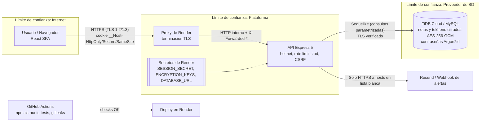

# Modelo de amenazas — SecureVault (A06 Insecure Design)

## Diagrama de flujo de datos

**Activos**: contenido de las notas, teléfono, credenciales, sesiones, llaves de cifrado y bitácora.

## Análisis STRIDE

| # | STRIDE | Amenaza | Mitigación implementada | Archivo |
|---|---|---|---|---|
| 1 | **S**poofing | Fuerza bruta / credential stuffing en login | Rate limit 5/15 min por IP (429), bloqueo progresivo por cuenta (1→60 min), Argon2id, alerta al 5.º fallo | `src/routes/auth.js` |
| 1b | Spoofing | Contraseña robada (phishing, filtración) | **MFA TOTP con Google Authenticator**: sin el código del teléfono no hay sesión; anti-replay; 5 intentos por login; códigos de respaldo | `src/routes/mfa.js`, `src/services/mfa.js` |
| 2 | Spoofing | Robo o fijación de sesión | Cookie `__Host-` HttpOnly/Secure/SameSite=Strict, `session.regenerate()` al autenticar, expiración 30 min / 8 h absoluta | `src/app.js`, `src/middleware/security.js` |
| 3 | Spoofing | Enumeración de usuarios | Mensajes genéricos en login/registro/recuperación; hash ficticio para igualar tiempos | `src/routes/auth.js`, `src/crypto/password.js` |
| 4 | **T**ampering | Modificación de notas cifradas en la BD | AES-256-GCM con tag de 16 bytes + AAD ligado a dueño y registro | `src/crypto/aes.js` |
| 5 | Tampering | CSRF (acciones en nombre del usuario) | Token CSRF en cabecera + verificación de `Origin` + SameSite=Strict | `src/middleware/security.js` |
| 6 | Tampering | Asignación masiva (`"role":"admin"` al registrarse) | Esquemas zod `.strict()` | `src/schemas.js` |
| 7 | Tampering | Dependencia comprometida | `package-lock.json`, `npm ci`, `npm audit`, Dependabot, SRI en CDN | `.github/` |
| 8 | **R**epudiation | Un usuario niega haber hecho algo | Bitácora de logins, accesos denegados, cambios de rol y revelación de datos | `src/services/audit.js` |
| 9 | **I**nformation disclosure | IDOR: leer notas ajenas | `WHERE id = ? AND owner_id = ?` en todas las consultas; respuesta 404 | `src/routes/notes.js` |
| 10 | Information disclosure | Robo de la base de datos | Notas/teléfono cifrados, contraseñas Argon2id, tokens como SHA-256; llaves fuera de la BD | `src/crypto/*` |
| 11 | Information disclosure | Fuga en errores / logs | Manejador global genérico; logs con redacción de cookie/password/token | `src/app.js`, `src/logger.js` |
| 12 | Information disclosure | XSS para robar datos | React escapa la salida, CSP `script-src 'self'`, sin `dangerouslySetInnerHTML` | `client/src`, `src/app.js` |
| 13 | Information disclosure | Token de recuperación en logs o Referer | Token en el fragmento `#` (no llega al servidor), `Referrer-Policy: no-referrer` | `src/services/mailer.js` |
| 14 | **D**enial of service | Inundación de peticiones / cuerpos enormes | Rate limit global 300/15 min, body máx. 20 KB, timeouts de servidor y BD | `src/app.js`, `src/server.js` |
| 15 | Denial of service | Llenar la BD | Máx. 100 notas por usuario, 10 000 caracteres por nota | `src/db/models.js` |
| 16 | **E**levation of privilege | Usuario accede al panel admin | `requireRole('admin')` en el servidor, denegación por defecto, intento registrado | `src/routes/admin.js` |
| 17 | Elevation of privilege | SSRF mediante peticiones salientes | `safeFetch` con lista blanca de hosts, solo HTTPS, sin redirecciones | `src/services/http.js` |

## Casos de abuso documentados

1. **Atacante prueba 1 000 contraseñas contra una cuenta** → al 6.º intento recibe 429; la cuenta queda bloqueada aunque cambie de IP; el admin recibe una alerta.
2. **Usuario B cambia el UUID en `/api/notes/:id` por el de A** → 404, y se registra `access_denied`.
3. **Atacante con acceso a un respaldo de la BD** → solo ve `v1.<iv>.<tag>.<datos>` y hashes `$argon2id$`; sin la llave (que está en Render, no en la BD) no puede leer nada.
4. **Página maliciosa intenta enviar un POST con la sesión de la víctima** → sin cookie (SameSite=Strict), sin token CSRF y con `Origin` ajeno: 403.
5. **Atacante intenta registrarse como admin** enviando `role` → 400 por campo no permitido.
6. **Atacante conoce la contraseña (filtrada)** pero la víctima tiene MFA → queda en estado "MFA pendiente" sin acceso a ningún recurso; 5 códigos erróneos cancelan el intento y se dispara una alerta.
7. **Atacante copia el teléfono cifrado de la víctima a su propio registro** → el AAD no coincide y el descifrado falla.

## Límites de negocio

| Límite | Valor |
|---|---|
| Notas por usuario | 100 |
| Título / contenido | 120 / 10 000 caracteres |
| Cuerpo de petición | 20 KB |
| Intentos de login | 5 por IP cada 15 min; bloqueo de cuenta progresivo desde el 5.º fallo |
| Registro / recuperación | 5 por IP cada 15 min |
| Token de recuperación | 15 min, un solo uso |
| Sesión | 30 min de inactividad, 8 h máximo |
